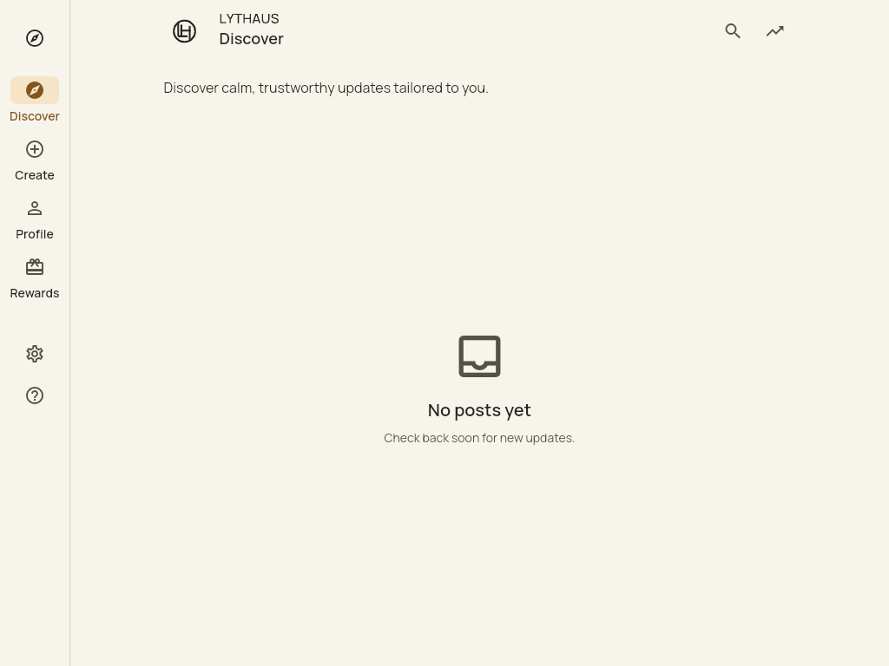
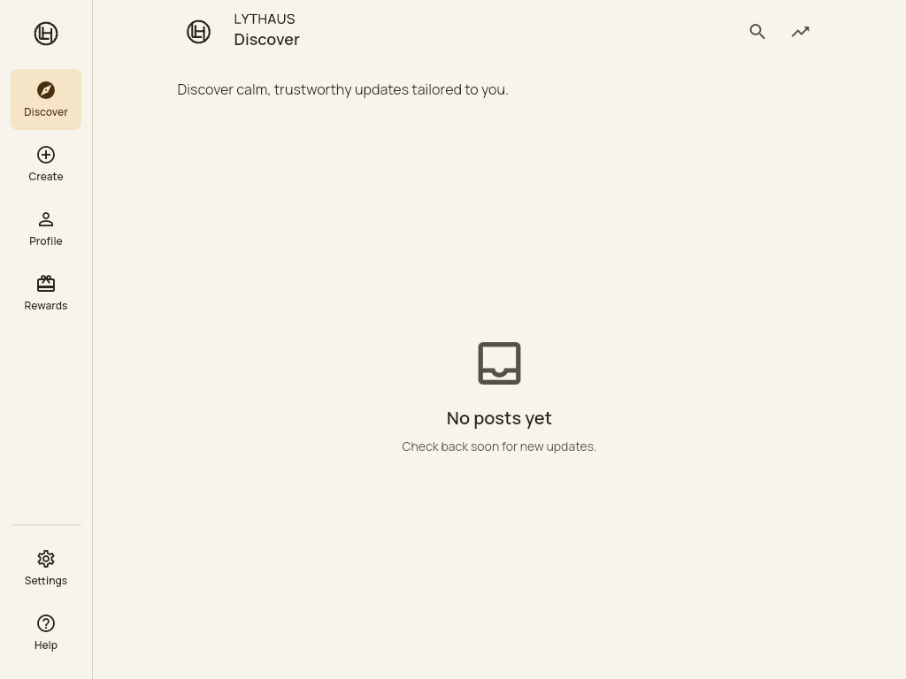
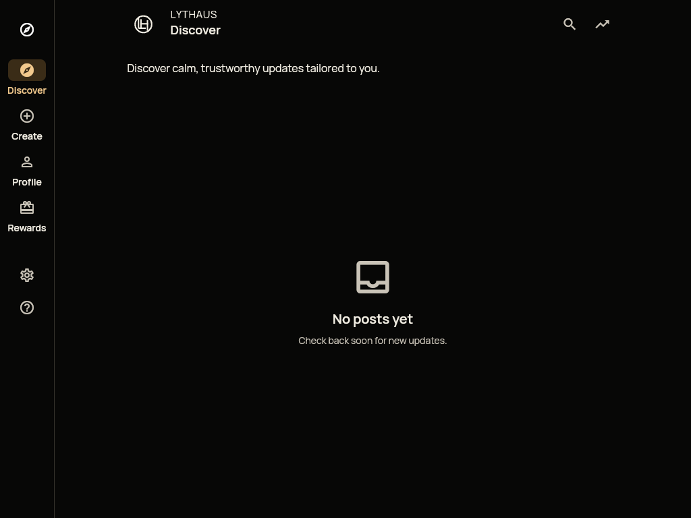
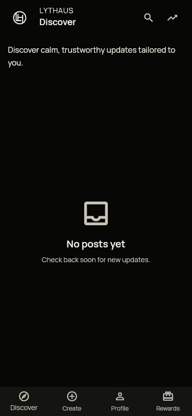
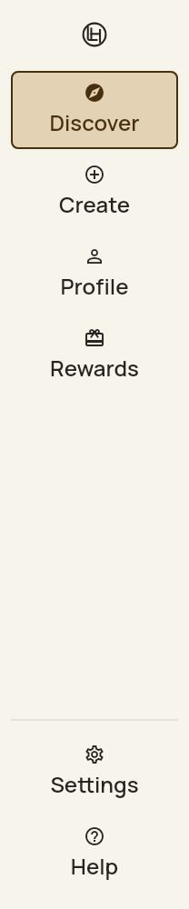
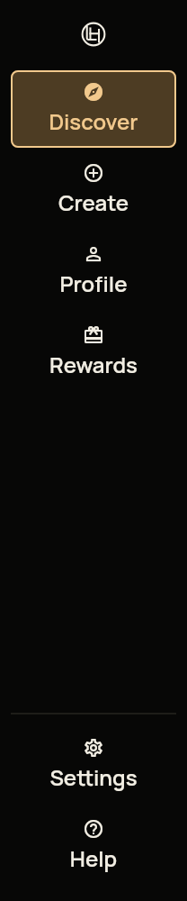
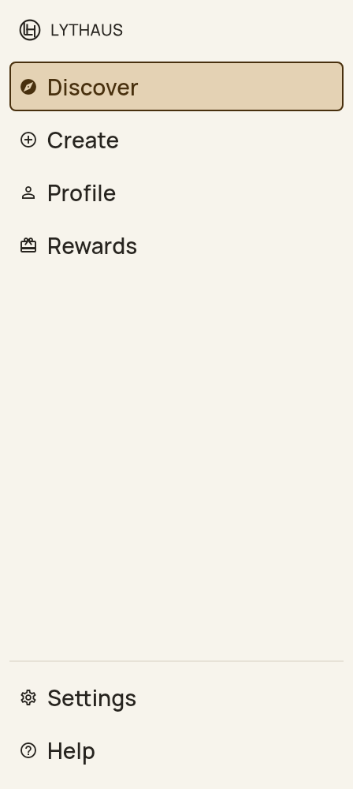
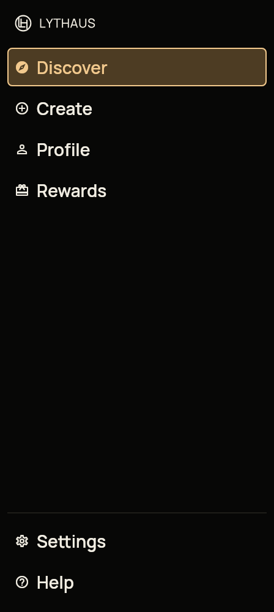

# Adaptive desktop navigation: retained review

[Resumed verification and 320px captures](resumed/README.md) document the later
composer-preservation fix and its tests. The comparisons below are historical.

This is a dependent change on PR1024. That branding PR remains held pending the
separate final-asset review and independent review. Kyle selected the A+E Balanced
connection uppercase LH direction; wordmark spacing remains with the logo lane.
The circular LH in historical captures is not approved as the final asset.
The navigation receives a passive `brand`
widget; it does not know which logo shape, image format or asset is supplied.
Existing candidate assets are reused without modification in these captures.

One component now presents the four existing destinations in both desktop modes.
Selected destinations have a quiet filled row and filled icon. Settings/Help share
a utility group at the bottom. Short windows scroll the navigation. Keyboard focus
uses a two-pixel contrasting outline, and the selected state belongs to the named,
focusable action. Sign-out remains Settings → Account security → Sign out of all
sessions, with its existing authentication and session-revocation behavior.

## Browser comparisons

| Viewport / appearance | Before | After |
| --- | --- | --- |
| 1024 × 768 / light |  |  |
| 1024 × 768 / dark |  |  |
| 1440 × 960 / light |  |  |
| 1440 × 960 / dark |  |  |
| 390 × 844 / light |  |  |
| 390 × 844 / dark |  |  |

Settings reached by Tab before Enter opens the existing route:
[compact light](after/light-1024-settings-focus.png),
[compact dark](after/dark-1024-settings-focus.png),
[expanded light](after/light-1440-settings-focus.png),
[expanded dark](after/dark-1440-settings-focus.png).

## Native enlarged text

These are actual Flutter `TextScaler.linear(2)` renders with Discover focused.
Rail width grows with text size; the shell retains its existing effective-width
breakpoint, so a 1440px window at 200% uses the unchanged mobile navigation.

| Mode | Light | Dark |
| --- | --- | --- |
| Compact / 200% |  |  |
| Expanded / 200% |  |  |
| Compact / 100% | [Light](native/light-compact-1x.png) | [Dark](native/dark-compact-1x.png) |
| Expanded / 100% | [Light](native/light-expanded-1x.png) | [Dark](native/dark-expanded-1x.png) |

## Scope and validation

Production ownership is exactly `lib/ui/components/lythaus_side_navigation.dart`
and the imports/desktop presentation of `lib/ui/screens/adaptive_shell.dart`.
Tests are `test/ui/components/lythaus_side_navigation_test.dart` and
`test/ui/screens/adaptive_shell_test.dart`. Evidence/reproducers live here.
No feed/profile/auth/root/router/reload/marketing source or brand asset changed.

- 211 scoped Flutter tests pass, including shared design-system and existing
  responsive/feed/guest regressions. Nine new component cases cover both themes,
  both desktop modes, 100%/200% text, all six callbacks, Tab/Shift-Tab/Enter/Space,
  selected/name/tap/focus semantics, 48px targets, 3:1 focus boundaries and 4.5:1
  label contrast against focused fills, short-window scrolling and a custom brand.
- Shell checks preserve Help success/failure handling, tab/query/back history,
  Create/Rewards guest gates, right/left-handed mobile ordering and tap mapping.
  Signed-in and guest fixtures verify sign-out reachability at 1024 and 1440px;
  the signed-in action calls the existing logout service and clears local user state.
- Full Flutter analysis reports no issues. Release web build passes with existing
  secure-storage Wasm dry-run warnings; the JavaScript build succeeds.
- Six before and six after browser scenarios pass. After desktop scenarios also
  exercise Rewards/Create gates, return to Discover, keyboard Settings entry and
  Account security, confirming guest sign-out stays disabled. All runs check page
  identity, meaningful content, asset decoding and unexpected console/runtime errors.

Before uses the compiled `ed56f6d11b41bc9cb29d45309a0d85ffd606001c` app; its
application sources are byte-identical to dependency base
`828ac58ddf7b49dd63339a677e2bdc4f7f2b82b3`, which only corrects evidence.
After and native captures use `35e54f1e34099ae7a750404f98ec038f6e4f26de`.
[manifest.json](manifest.json) records capture times, exact sources and SHA-256s.
Receipts: [before](before/results.json), [after](after/results.json),
[native](native/results.json). Images are retained without cropping or retouching.

## Reproduction and limits

Use Flutter 3.41.1 / Dart 3.11.0 (`.fvmrc`) and the existing Playwright Chromium
151.0.7922.34 installation. The Browser plugin is unavailable in this environment.
From a clean checkout of the desired source revision:

```sh
source cloudflare/pages-release.sh
flutter build web --no-pub --release --no-web-resources-cdn \
  --dart-define=ENVIRONMENT=production \
  --dart-define=AUTH_URL="$AUTH_URL" --dart-define=API_BASE_URL="$API_BASE_URL"
LYTHAUS_NAV_SOURCE="$(git rev-parse HEAD)" \
  node docs/evidence/adaptive-navigation-20261015/capture.mjs after
node docs/evidence/adaptive-navigation-20261015/capture-native.mjs
```

Both reproducers create fresh temporary output. Browser `LYTHAUS_NAV_BUILD` selects
an isolated baseline build; use phase `before` and its actual compiled source hash.
The native script requires a clean tree and records test results and source hashes.
The browser fixture uses a local TLS proxy and synthetic empty guest responses,
blocks production requests, and excludes only the expected guest refresh 401.
No production auth/publishing/detection/rewards certification, physical-device or
manual screen-reader validation is claimed. No merge or deployment was performed.
