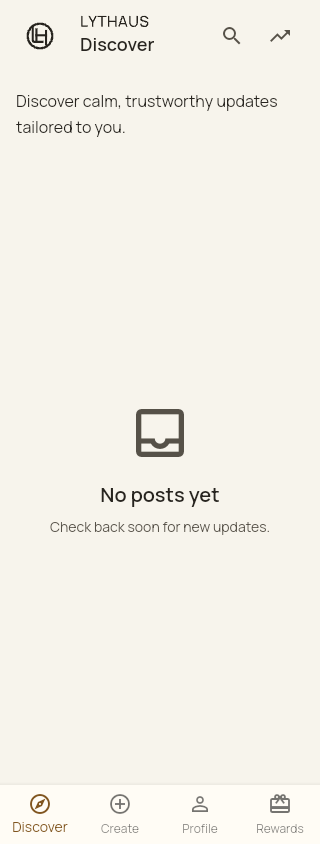
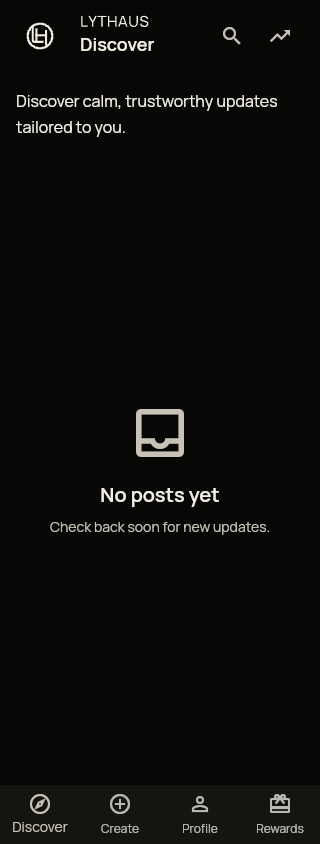
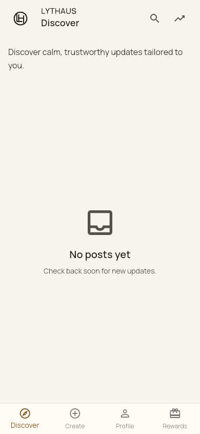
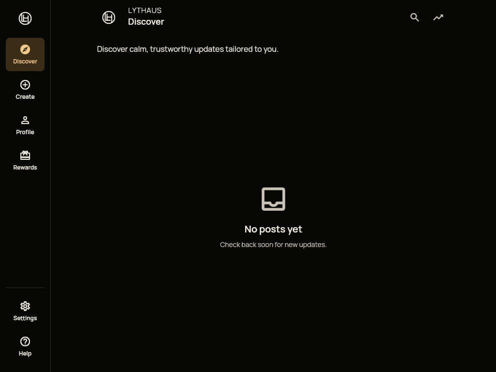
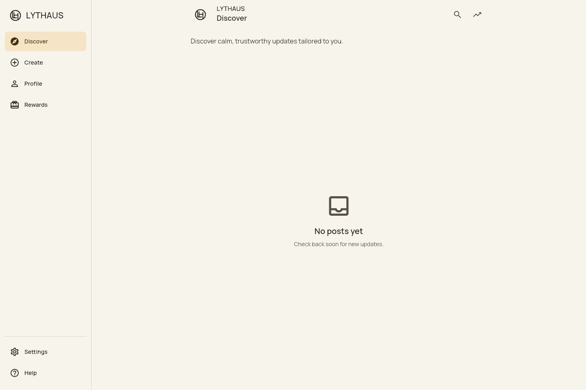
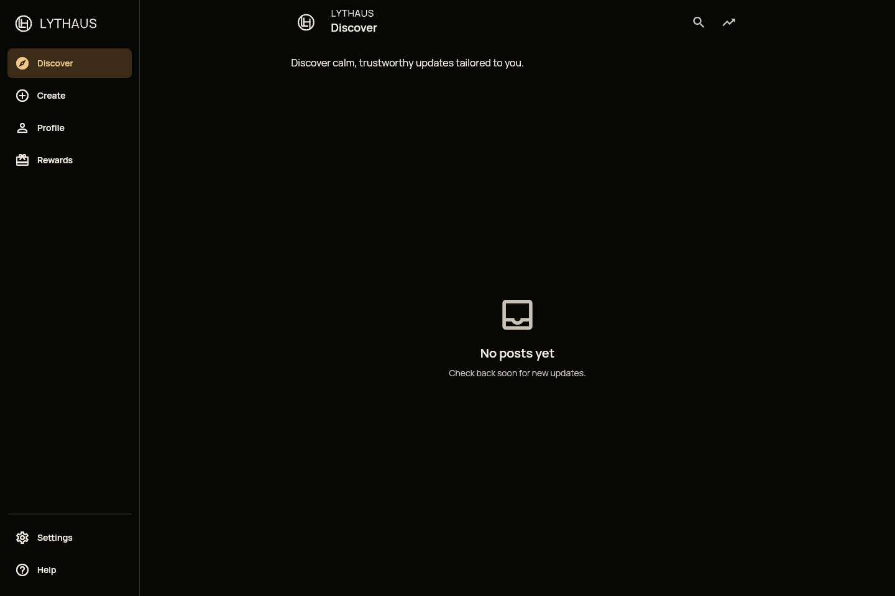

# Resumed shell verification — 15 October 2026

Resizing the shell from mobile to desktop disposed the active composer because
the content moved into a different parent. `ui-resize-before.log` records the
reproduced failure. A shell-owned global key now preserves the content subtree
through that move. The regression checks composer/controller identity, draft
text and selection through 390 → 1024 → 1440 → 320 → 390px, with tab changes at
each size. It then signs out and resizes again, verifying that protected composer
content is removed and the guest Create gate appears. No publishing is exercised.

## Validation

- `ui-tests.log`: 212 scoped tests passed after the production fix.
- `ui-shell-final.log`: all 18 shell tests passed after adding the sign-out check.
- `ui-analyze.log`: full Flutter analysis passed. Pinned Dart formatting passes.
- `ui-web-build.log`: release JavaScript build passed; existing secure-storage
  WebAssembly dry-run warnings remain.
- `results.json`: eight compiled browser scenarios, light/dark at 320, 390, 1024
  and 1440px, with no unexpected console/runtime errors. Every scenario exercises
  keyboard Feed controls. Desktop scenarios also exercise guest Create/Rewards
  gates, Discover return and keyboard Settings → Account security with disabled
  guest sign-out. Mobile tab mapping remains covered by native shell tests.

The compiled application source is `7c6045ebc0bfc44f27a9ceef71ea8929d87958bf`.
The subsequent commit changes only test formatting, the sign-out regression and
retained evidence. The application source is unchanged. The browser receipt
records the compiled JavaScript SHA-256 and browser version; `sha256.json` hashes
the generated captures, receipt and logs. Images are unretouched.

| Width | Light | Dark |
| --- | --- | --- |
| 320 |  |  |
| 390 |  |  |
| 1024 |  |  |
| 1440 |  |  |

## Release boundaries

PR1027 remains stacked on PR1024 at
`828ac58ddf7b49dd63339a677e2bdc4f7f2b82b3`. The navigation accepts an arbitrary
brand widget. Removing the dependency would require changing the shell brand
presentation and recapturing its baseline; the existing stack is retained without
rewriting either PR. The circular LH shown here is a provisional candidate, not
the final owner-selected logo. Kyle selected the separate A+E Balanced connection
uppercase LH direction; final assets/wordmark spacing remain with the logo lane.

Live main was `53ac0f4ece621605762cde8d9a42f7dde8362ca9`. `git merge-tree
--write-tree origin/main HEAD` was conflict-free; this is not integration-test
certification. Main's separate reload change is not copied into this stacked PR.
Required exact-head CI and independent review remain release gates. No merge,
deployment, provider mutation or feature activation is performed. PR1025 feed,
provider and harness files are untouched. These synthetic fixtures do not certify
production authentication, publishing, detection, or manual screen-reader usage.
