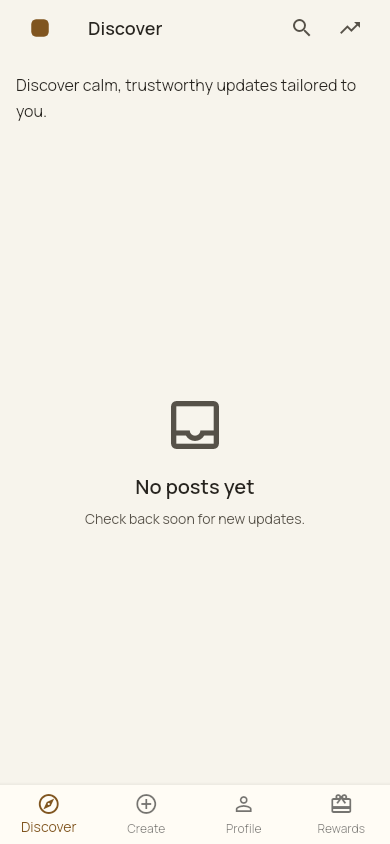
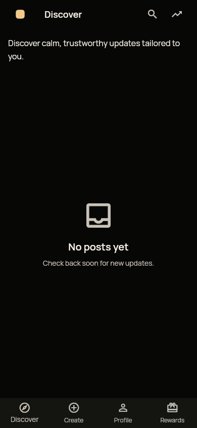
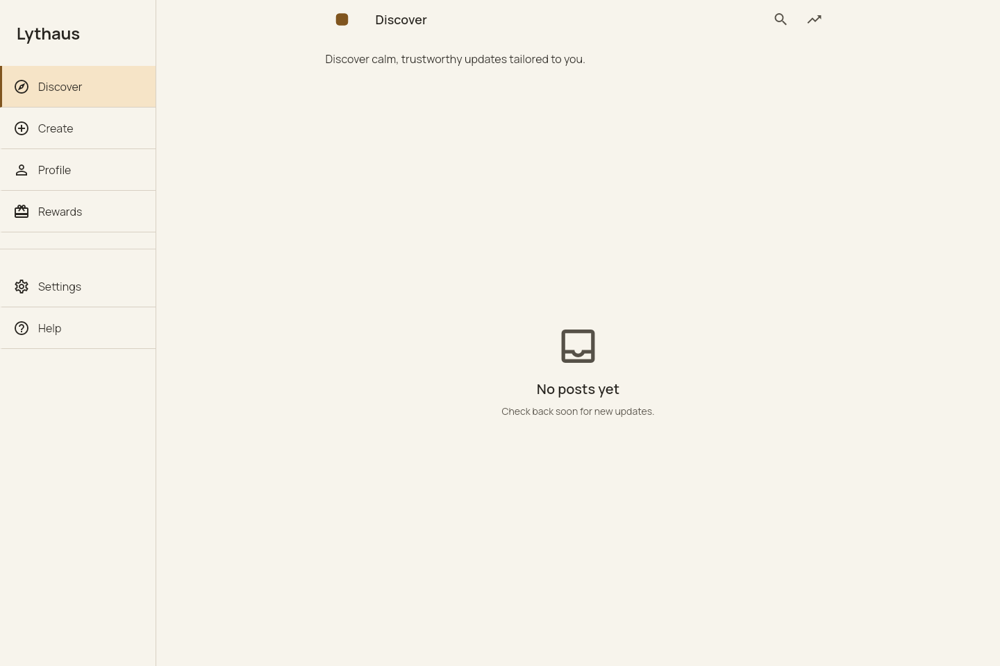
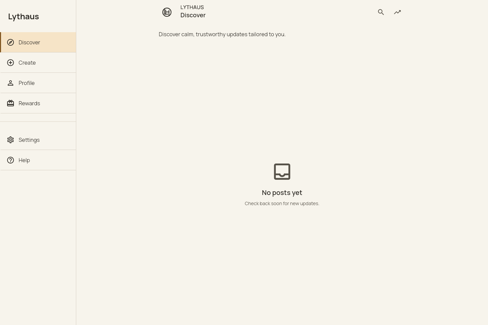
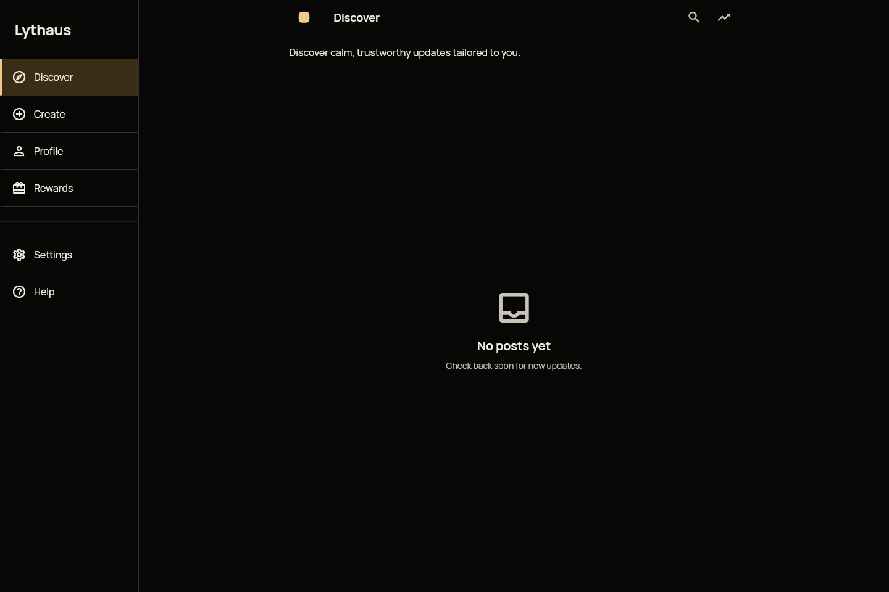
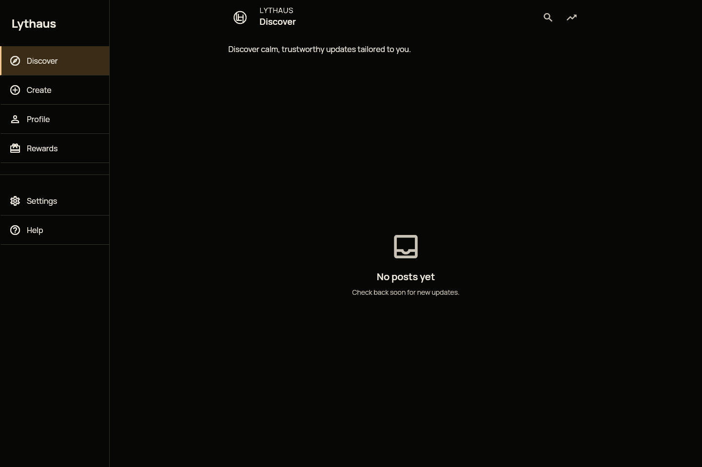
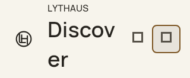
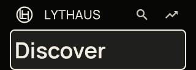
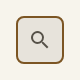
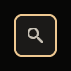

# App brand foundation: retained visual review

These screenshots are committed evidence for PR1024 and can be inspected directly
in GitHub. Before: `489aef297ff0b1a40744504594122c9ebc43930d` (main).
After: `dff240c8b80f8e34316016de6049bc273709d8a6` (brand implementation).
The follow-up corrects the filled icon variant's foreground and inset focus border; separate
captures below show that fix. The existing header captures remain representative
because its standard icon controls are unchanged by the follow-up.
[manifest.json](manifest.json) identifies each capture, size, timestamp, source
commit and SHA-256. Images are retained unchanged, without cropping or retouching.

## Before and after

| Appearance / viewport | Before | After |
| --- | --- | --- |
| Light / 390 × 844 |  |  |
| Dark / 390 × 844 |  |  |
| Light / 1440 × 960 |  |  |
| Dark / 1440 × 960 |  |  |

The approved LH mark replaces the solid brown tile. The static wordmark sits
within the existing feed header; the sidebar and feed content are unchanged.
Light/dark tokens, typography and spacing are the existing shared foundation.

## Keyboard and enlarged text

Tab reaches Feed controls; Enter opens the existing selector; Close returns to
the header. The two-pixel focus boundary is visible in these browser captures:
[light mobile](after/light-390-focus.png), [dark mobile](after/dark-390-focus.png),
[light desktop](after/light-1440-focus.png), [dark desktop](after/dark-1440-focus.png).

Native Flutter headers at 200% text scaling:

| Width | Light | Dark |
| --- | --- | --- |
| 320 |  |  |
| 390 | [Light](headers/light-390-2x.png) | [Dark](headers/dark-390-2x.png) |
| 1440 | [Light](headers/light-1440-2x.png) | [Dark](headers/dark-1440-2x.png) |

These use `TextScaler.linear(2)`, not browser zoom. Header captures follow keyboard
traversal of all four actions. On mobile the title occupies its own row and focus
ends on that title; on desktop focus ends on Trending. The distinct action names,
brand image labels and actual focused Material boundaries are covered by
`test/design_system/brand_accessibility_test.dart` in both appearances.

All shared icon variants after keyboard focus:

| Variant | Light | Dark |
| --- | --- | --- |
| Standard |  |  |
| Filled |  |  |
| Outlined |  |  |

The filled variant previously used a primary border against its primary fill,
yielding 1:1 contrast, and inherited the plain-button glyph color. Its enabled
default glyph and two-pixel inset border now use `onPrimary`. Tests check
at least 3:1 against the actual Material fill and the composited focused fill.
Enabled glyphs also pass 3:1 against their rendered fills. Standard/outlined
borders are also checked against the exterior canvas. The
manifest records the source content hash for these follow-up icon captures.

## Reproduction and limits

Flutter 3.41.1 / Dart 3.11.0 match `.fvmrc`; Chromium is 151.0.7922.34. Both builds
use `cloudflare/pages-release.sh`. A local TLS proxy serves all app assets and
synthetic API responses; the apparent app URL is `https://app.lythaus.co/`.
No production API calls are made. The Browser plugin was unavailable, so the
existing Playwright/browser installation was used.

From the repository root, using the existing SDK, package cache and browser:

```sh
source cloudflare/pages-release.sh
flutter build web --no-pub --release --no-web-resources-cdn \
  --dart-define=ENVIRONMENT=production \
  --dart-define=AUTH_URL="$AUTH_URL" --dart-define=API_BASE_URL="$API_BASE_URL"
node docs/evidence/app-brand-foundation-20261015/capture.mjs after
LYTHAUS_BRAND_EVIDENCE=/tmp/lythaus-brand-evidence/headers \
  flutter test --no-pub test/design_system/brand_foundation_test.dart
LYTHAUS_BRAND_EVIDENCE=/tmp/lythaus-brand-evidence/icons \
  flutter test --no-pub test/design_system/brand_accessibility_test.dart
node --test scripts/tests/app-brand-assets.test.mjs
```

Use `LYTHAUS_BRAND_BUILD` to select an isolated baseline build and pass `before`
to the capture script; `LYTHAUS_BRAND_OUTPUT` changes the output directory.
The capture script writes to temporary output by default, never this evidence
directory. Full receipts: [before](before/results.json), [after](after/results.json).
Both runs recorded four viewports/themes and no unexpected console/runtime errors.
The synthetic guest's expected 401 refresh rejection is excluded from errors.

This proves scoped rendered branding and interactions. It does not certify
production auth/publishing/detection/rewards, physical devices or manual
screen-reader behavior. The existing marketing 64-pixel favicon has a broken PNG
stream; the app instead uses the valid approved 192-pixel artwork unchanged.
Marketing files remain untouched.
